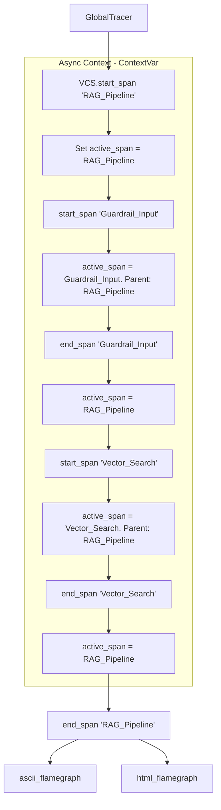

# LLM Observability Tracer

End-to-end monitoring, profiling, and telemetry engine designed to record the execution of language model (LLM) calls, token consumption, API cost estimates, and process latencies through structured execution trees (Spans).

This module allows injecting deep observability into complex pipelines (such as RAG or autonomous agent systems) and exporting detailed logs and interactive performance analysis interfaces (HTML and ASCII Flame Graphs).

## Telemetry Architecture and Span Stack

The system is structured around temporal units of work (Spans) organized hierarchically to trace execution bottlenecks.



### 1. Hierarchical Span Representation

A **Span** is the logical representation of a task or callback (e.g., vector search, classification, inference, etc.). Each `SpanModel` object is persisted and instrumented with the following properties:
*   `id` and `parent_id`: UUID identifiers that allow reconstructing the call tree (Directed Graph).
*   `start_time` and `end_time`: High-precision floating-point timestamps used to calculate latency:
    $$\text{Latency} = \text{end\_time} - \text{start\_time}$$
*   `inputs` and `outputs`: Structured dictionaries that audit the step's arguments and responses.
*   `metadata`: Open dictionary that stores specific telemetry such as `input_tokens`, `output_tokens`, `model_name`, and `cost`.

### 2. Async Isolation via ContextVar

To support concurrent serving in web APIs (FastAPI/Uvicorn) or parallel execution in subprocesses without mixing the trace trees of different users' requests, the engine manages the active span state using:

```python
_active_span_var: ContextVar[Optional[SpanModel]] = ContextVar("active_span", default=None)
```

When calling `start_span(name)`:
1.  The tracer retrieves the active span in the current thread or coroutine: `parent = _active_span_var.get()`.
2.  If a parent exists, the new span is appended as a child of it. If not, it is registered as a Root Span (`root_spans`).
3.  The local context pointer is updated: `_active_span_var.set(new_span)`.

When calling `end_span()`:
1.  The temporal window of the current active span is closed.
2.  The context pointer reverts to the corresponding parent id: `_active_span_var.set(parent)`.

### 3. Exportable Visualizations (Flame Graphs)

The tracer provides two graphical latency diagnostic interfaces:
*   **ASCII Flame Graph:** Formats the Span tree in the console indenting the hierarchy, injecting success/error colors, latency in milliseconds, token count, and accumulated cost in dollars.
*   **Interactive HTML Flame Graph Visualizer:** Exports a standalone, independent static web application configured with a modern dark violet aesthetic. The application embeds the JSON data structure and renders interactive relative-duration bars, enabling floating panels with input/output details when clicking on the blocks.

## Connection to the Ecosystem

This module acts as the central inspector of the suite:
1.  **hybrid-search-retrieval-pipeline:** Instruments calls to BM25 and NanoVectorDB to audit the partial times of sparse vs. dense search.
2.  **llm-inference-server / semantic-model-router:** Measures the time spent on token generation, collects the actual token count returned by the backend, and calculates the dollar cost of routing.
3.  **orchestra-agents / secure-tool-runtime:** Records the trace of the agent's ReAct loop, detailing the duration of each thought step and the performance of the tool execution sandbox.

## Project Structure

*   `tracer.py`: Defines the Pydantic `SpanModel` schema, the `ContextVar` contextual variable, and the `GlobalTracer` class with the ASCII and HTML rendering methods.
*   `test_tracer.py`: Unit test suite that checks the tree hierarchy, the stability of the isolated async context under concurrent executions, exception capture, and cost calculation.
*   `example.py`: Interactive simulation script that instruments a complete RAG flow with nested database calls, rerankers, and guardrails, printing the report to the console and generating the HTML visualizer on disk.

## Using it as a package

Since `0.1.0` the code lives in the `llm_observability_tracer` package and the repository is
pip-installable, so other projects can depend on it instead of copying files
or editing `sys.path`:

```bash
pip install "llm-observability-tracer @ git+https://github.com/juanmmm21/llm-observability-tracer.git@v0.1.0"
```

```python
from llm_observability_tracer import SpanModel, GlobalTracer
```

The old top-level modules are kept as thin re-exports, so scripts that add
this folder to `sys.path` keep working. This component imports no other
ai-core component: they are combined in the `aicore` SDK of
[ai-core-infra-hub](https://github.com/juanmmm21/ai-core-infra-hub), which
passes collaborators (vector stores, encoders, tokenizers) in by injection.

Development: `pip install -e ".[dev]"`, then `pytest` and `ruff check .`.

## Installation and Execution

### 1. Activate the Local Environment and Install Dependencies

Since the module leverages Python's native context control libraries, the dependencies are minimal:

```bash
python3 -m venv .venv
source .venv/bin/activate
pip install -r requirements.txt
```

### 2. Run Telemetry Tests

```bash
.venv/bin/python -m unittest test_tracer.py
```

### 3. Run Monitoring Demo

```bash
.venv/bin/python example.py
```

The script will simulate a multi-agent RAG orchestration call and generate the hierarchical report in the console. It will also create the interactive `observability_flamegraph.html` file in the execution directory to be inspected in the web browser.
